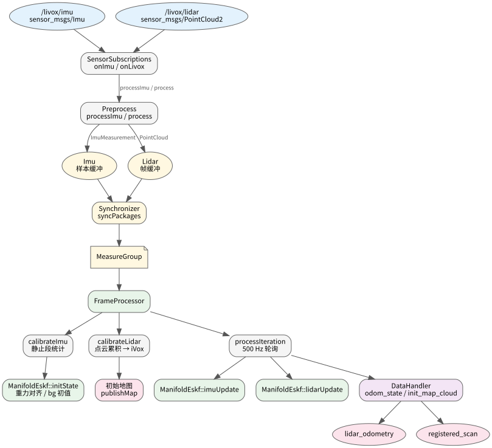

# point_LIO

LIO, 雷达-惯性里程计, 接受雷达与IMU的数据, 通过构造流形卡尔曼滤波, 逐点更新小车的位姿, 同时将点云更新至 odometry 坐标系下并下采样, 以供后续节点使用, 是整个导航系统的开端.
*guganav特供: 目前与 gicp 联动以实现在线建图.

## 架构



启动节点为`src/guga_localization/LIO/point_lio/src/ros2/laserMapping.cpp`,
1. 构造节点类时, 注册 yaml 参数, 将其通过 datahandler 类分发至各类中, 之后完成 ros2 publisher 与 subscription 的注册.
2. 完成全局初始化后,进行标定: 先通过 imu 与重力来初始化标定z轴的方向, 然后累积点云进行初始化点云的发布.
3. 准备工作就绪,开始循环: 获取imu/雷达数据 -> 卡尔曼滤波更新传播 -> 发布所需数据


## 主数据流

```
传感器
  ├─ /livox/imu  ──
  └─ /livox/lidar──point_LIO
                      
                      │
                      │
                      │
                      ├─(lidar_odometry)──── terrain_analysis
                      │(registered_scan)     │
                      │                      ├─(terrain_map)─────────── local_costmap / global_costmap
                      │                      │                          (obstacle_layer, pb_nav2_plugins)
                      │                      │                          └ SLAM 模式：pointcloud_to_laserscan
                      │                      │                            → slam_toolbox (map)
                      │                      └─(terrain_returns_current) local_costmap / global_costmap
                      │                         (obstacle_layer, 只做清除)
                      └─(registered_scan)────small_gicp

```


## 输入

| 来源包/节点     | Topic          | 消息类型                  | QoS                     |
| --------------- | -------------- | ------------------------- | ----------------------- |
| `serial_driver` | `/livox/imu`   | `nav_msgs/Odometry`       | rclcpp::SensorDataQoS() |
| `serial_driver` | `/livox/lidar` | `sensor_msgs/PointCloud2` | rclcpp::SensorDataQoS() |

## 输出

| 话题                     | 类型                      | 坐标系        | 发布者                            | 说明                                                           |
| ------------------------ | ------------------------- | ------------- | --------------------------------- | -------------------------------------------------------------- |
| `cloud_registered`       | `sensor_msgs/PointCloud2` | `camera_init` | `FramePublisher::publishWorld`    | 当前帧配准后的世界系点云，未经 `body_to_base` 投影             |
| `Laser_map`              | `sensor_msgs/PointCloud2` | `camera_init` | `FramePublisher::publishMap`      | 标定阶段累积的初始地图，只发布一次                             |
| `registered_scan`        | `sensor_msgs/PointCloud2` | `odom`        | `ProjectOutputPublisher::publish` | 经 `body_to_base_r/t` 投影并按 `z_filter` 带通滤波，供导航使用 |
| `lidar_odometry`         | `nav_msgs/Odometry`       | `odom`        | `ProjectOutputPublisher::publish` | 投影后的位姿，`child_frame_id` 为 `lidar_frame`                |
| `/point_lio/debug_state` | `std_msgs/String`         | 无            | `laserMapping.cpp`                | 打开 `publish.debug_state_en` 时发布状态向量文本               |

`cloud_registered` 和 `Laser_map` 在 `camera_init` 系，`registered_scan` 和 `lidar_odometry` 在 `odom` 系。两套坐标系的差别是启动时由 `output_frame.body_to_base_r/t` 给出的固定变换。

## 文件

头文件在 `include/point_lio/` 下按层组织。

### 节点层 `ros2/`

- `laserMapping.h`：节点类，负责参数、订阅发布注册、标定与主循环的驱动。
- `sub/SensorSubscriptions.h`：IMU 与雷达订阅，把 ROS 消息转成内部类型后交给 `FrameProcessor`。
- `pub/FramePublisher.h`：`camera_init` 系的点云与初始地图发布。
- `pub/ProjectOutputPublisher.h`：投影到 `odom` 系后发布点云与里程计。
- `ros_time.h`：秒到 `rclcpp::Time` 的转换。

### 调度层 `core/`

- `FrameProcessor.h`：帧调度，对外只有 `calibrate`（标定）和 `processIteration`（跟踪）两个入口。
- `Synchronizer.h`：按雷达帧结束时间从 IMU 队列取样本，组装 `MeasureGroup`。
- `DataHandler.h`：跨模块数据仓库，保存配置、滤波器状态、里程计与初始地图点云。

### 滤波器 `core/`

- `ManifoldEskf.h`：24 维流形 ESKF，含 `initState`、`imuUpdate`、`lidarUpdate` 三个入口。
- `Imu.h`：IMU 样本缓冲与静止段统计，输出 `ImuInitEstimate`。
- `Lidar.h`：雷达帧缓冲、帧结束时间计算、雷达相对 IMU 的外参。
- `PointTypes.h`：点类型与时间偏移的读写。

### 工具层 `utilities/`

- `preprocess.h`：多型号雷达的点云预处理，以及 `processImu` 的 IMU 消息转换。
- `common_lib.h`：`State`、`MeasureGroup`、`ImuSample`、`FilterOutput` 等公共类型。
- `OdomProcessor.h`：`body_to_base` 固定变换，把 `camera_init` 系结果投影到 `base` 系。

### 参数与可选模块

- `core/parameters.h`：所有参数结构体。
- `pcd/PriorMapManager.h`：先验地图累积与重载，由 GICP 定位状态驱动。
- `ivox/`：iVox 增量地图，第三方实现。

## 参数

参数由 `src/ros2/laserMapping.cpp` 的 `initializeParameters` 声明，来自 `src/guga_bringup/config/<profile>/base.yaml` 的 `point_lio:` 段，实车与仿真各一份。下表按用途分组，默认值取节点声明里的值。

### 输入与传感器

| 参数                            | 类型   | 默认           | 作用                                |
| ------------------------------- | ------ | -------------- | ----------------------------------- |
| `common.lid_topic`              | string | `.livox.lidar` | 雷达话题，yaml 覆盖为 `livox/lidar` |
| `common.imu_topic`              | string | `.livox.imu`   | IMU 话题，yaml 覆盖为 `livox/imu`   |
| `common.time_diff_lidar_to_imu` | double | 0.0            | 雷达与 IMU 的时间偏移，单位秒       |
| `mapping.extrinsic_T`           | vector | 空             | 雷达在 IMU 系下的平移               |
| `mapping.extrinsic_R`           | vector | 空             | 雷达在 IMU 系下的旋转，行主序 9 元  |

### 预处理

| 参数                        | 类型   | 默认 | 作用                                       |
| --------------------------- | ------ | ---- | ------------------------------------------ |
| `preprocess.lidar_type`     | long   | 1    | 1 Livox、2 Velodyne、3 Ouster              |
| `preprocess.scan_line`      | long   | 16   | 扫描线数，Livox 填实际线数                 |
| `preprocess.scan_rate`      | long   | 10   | 雷达频率，单位 Hz                          |
| `preprocess.timestamp_unit` | long   | 1    | 点时间戳单位：0 秒、1 毫秒、2 微秒、3 纳秒 |
| `preprocess.blind`          | double | 1.0  | 盲区距离，单位米，此距离内的点丢弃         |
| `point_filter_num`          | long   | 2    | 预处理抽稀，每 N 个点取 1 个               |
| `mapping.det_range`         | double | 300  | 最大检测距离，单位米                       |

### 建图与降采样

| 参数                           | 类型   | 默认 | 作用                                   |
| ------------------------------ | ------ | ---- | -------------------------------------- |
| `init_map_size`                | long   | 100  | 初始地图累积的点数阈值，达到后进入跟踪 |
| `filter_size_surf`             | double | 0.5  | 帧内体素降采样尺寸，单位米             |
| `filter_size_map`              | double | 0.5  | 地图增量判重时用的体素尺寸             |
| `mapping.ivox_grid_resolution` | double | 0.2  | iVox 地图体素分辨率                    |
| `ivox_nearby_type`             | long   | 18   | iVox 邻域类型：0、6、18、26            |
| `mapping.plane_thr`            | double | 0.05 | 平面判定阈值，越小越严格               |
| `mapping.match_s`              | double | 81   | 点面匹配的残差上界                     |
| `mapping.lidar_time_inte`      | double | 0.1  | 雷达帧时间间隔，单位秒                 |

### IMU 与噪声

| 参数                           | 类型   | 默认   | 作用                                                     |
| ------------------------------ | ------ | ------ | -------------------------------------------------------- |
| `check_satu`                   | bool   | true   | 是否检查 IMU 饱和                                        |
| `mapping.satu_acc`             | double | 3.0    | 加速度饱和阈值                                           |
| `mapping.satu_gyro`            | double | 35.0   | 角速度饱和阈值                                           |
| `mapping.acc_norm`             | double | 1.0    | 加速度单位：1.0 表示以 g 为单位，9.81 表示以 m/s² 为单位 |
| `mapping.imu_acc_spike_thresh` | double | 0.0    | 比力模长低于 g 减该值时判为坏点，0 关闭                  |
| `mapping.imu_acc_spike_max`    | double | 0.0    | 比力模长上限，超过则丢弃，0 关闭                         |
| `mapping.gravity`              | vector | 空     | 重力方向，用于重力对齐                                   |
| `mapping.gravity_init`         | vector | 空     | 首帧 IMU 系下的先验重力                                  |
| `mapping.lidar_meas_cov`       | double | 0.1    | 雷达点面量测的观测噪声                                   |
| `mapping.imu_meas_acc_cov`     | double | 0.1    | 加速度量测噪声                                           |
| `mapping.imu_meas_omg_cov`     | double | 0.1    | 角速度量测噪声                                           |
| `mapping.gyr_cov_input`        | double | 0.1    | 角速度过程噪声（IMU 作为输入模型时）                     |
| `mapping.acc_cov_input`        | double | 0.1    | 加速度过程噪声（IMU 作为输入模型时）                     |
| `mapping.gyr_cov_output`       | double | 0.1    | 角速度过程噪声（IMU 作为状态时）                         |
| `mapping.acc_cov_output`       | double | 0.1    | 加速度过程噪声（IMU 作为状态时）                         |
| `mapping.b_gyr_cov`            | double | 0.0001 | 陀螺零偏的随机游走方差                                   |
| `mapping.b_acc_cov`            | double | 0.0001 | 加速度零偏的随机游走方差，也是初始协方差                 |
| `mapping.gyr_cov_output`       | double | 0.1    | 角速度过程噪声（IMU 作为状态时）                         |

### 输出坐标系

| 参数                                 | 类型   | 默认              | 作用                                          |
| ------------------------------------ | ------ | ----------------- | --------------------------------------------- |
| `output_frame.odom_frame`            | string | `odom`            | 输出里程计所在的坐标系名                      |
| `output_frame.lidar_frame`           | string | `front_mid360`    | 雷达坐标系名                                  |
| `output_frame.base_frame`            | string | `base_footprint`  | 车体基准坐标系名                              |
| `output_frame.registered_scan_topic` | string | `registered_scan` | 配准点云话题                                  |
| `output_frame.lidar_odometry_topic`  | string | `lidar_odometry`  | 雷达里程计话题                                |
| `output_frame.body_to_base_t`        | vector | 空                | `base <- body` 的平移，缺省则无法解析输出变换 |
| `output_frame.body_to_base_r`        | vector | 空                | `base <- body` 的旋转，行主序 9 元            |
| `output_frame.z_filter.enable`       | bool   | false             | 是否对输出点云做 Z 带通滤波                   |
| `output_frame.z_filter.min_z`        | double | -0.2              | Z 带通下界，`odom` 系                         |
| `output_frame.z_filter.max_z`        | double | 1.0               | Z 带通上界，`odom` 系                         |

### 发布与 PCD 保存

| 参数                                           | 类型   | 默认  | 作用                                         |
| ---------------------------------------------- | ------ | ----- | -------------------------------------------- |
| `publish.scan_publish_en`                      | bool   | true  | 是否发布配准点云                             |
| `publish.debug_state_en`                       | bool   | false | 是否发布 `/point_lio/debug_state`            |
| `odometry.publish_odometry_without_downsample` | bool   | false | 是否在每段 LiDAR 更新后立刻发布里程计        |
| `pcd_save.pcd_save_en`                         | bool   | false | 是否保存 PCD                                 |
| `pcd_save.interval`                            | long   | -1    | 每个 PCD 保存多少帧，-1 表示全部写进一个文件 |
| `pcd_save.path`                                | string | 空    | 保存目录，空则用默认位置                     |
| `pcd_save.require_lost`                        | bool   | false | 是否等 LOST 触发才保存                       |
| `pcd_save.trigger_topic`                       | string | 空    | LOST 触发话题                                |
| `pcd_save.state_topic`                         | string | 空    | 定位状态话题，SUSPECT 累积、LOST 写盘        |
| `pcd_save.reload_service`                      | string | 空    | 写盘后调用的重载服务名                       |
| `pcd_save.suspect_build_delay_sec`             | double | 3.0   | SUSPECT 累计多久后增量更新并重载             |

## 测试

`test/` 下是 gtest 单元测试，覆盖 `OdomProcessor` 的变换解析和 `ManifoldEskf::initState` 的重力对齐。

```bash
colcon build --packages-select point_lio --cmake-args -DBUILD_TESTING=ON
colcon test --packages-select point_lio
```

两个测试目标，共六个用例：

- `OdomProcessor.ResolveFromParams`：合法的 9 元和 3 元数组能解析出正确的旋转与平移。
- `OdomProcessor.FillOrderIsRowMajor`：确认 `<<` 按行填充，前三个数对应旋转矩阵第一行。
- `OdomProcessor.MissingParamsRejected`：数组长度不对时 `resolve` 返回 `false`。
- `EskfInit.NoStaticSamplesKeepsIdentity`：没有静止样本时旋转为单位阵、加速度取重力反方向。
- `EskfInit.LevelStaticAlignsGravity`：水平静止时旋转接近单位阵、零偏取均值。
- `EskfInit.TiltedStaticAlignsGravityDirection`：倾斜静止时旋转把机体测得的重力方向转到世界系。

`test_odom_processor` 只调用 `rclcpp::get_logger`，不初始化节点，不需要可写的 `~/.ros`。其他会创建节点的测试（例如 `terrain_analysis` 的集成测试）在只读 `$HOME` 的沙箱里需要把 `ROS_HOME` 指到可写目录：

```bash
export ROS_HOME=$(mktemp -d)
export ROS_LOG_DIR=$ROS_HOME/log
```